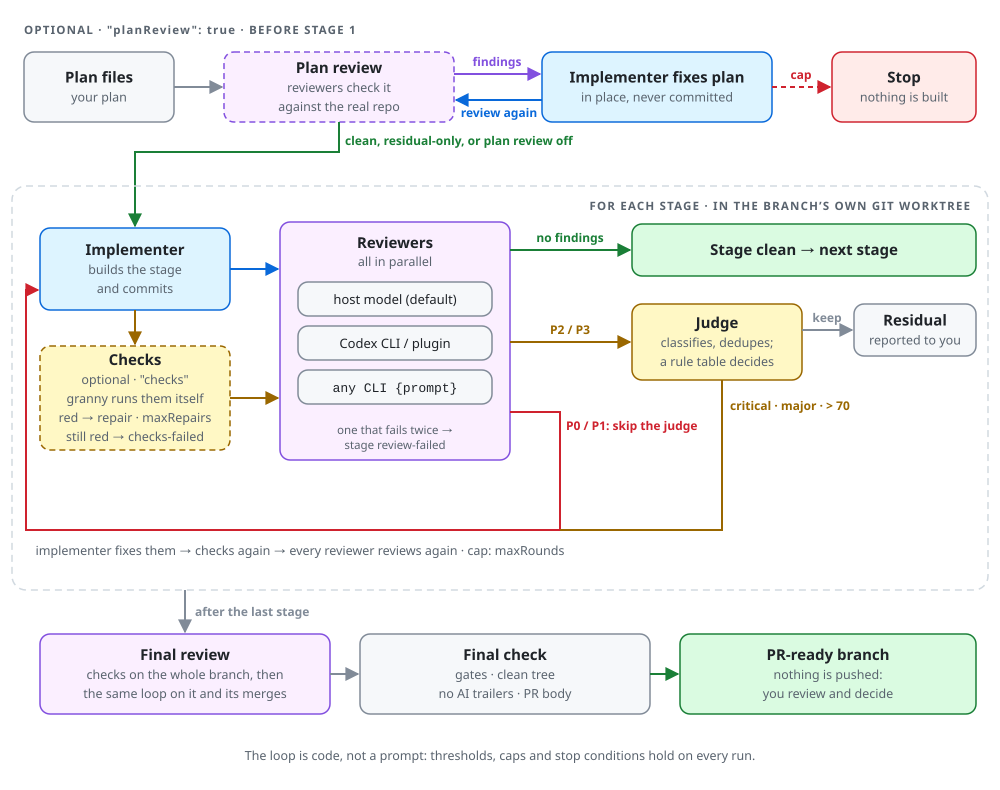
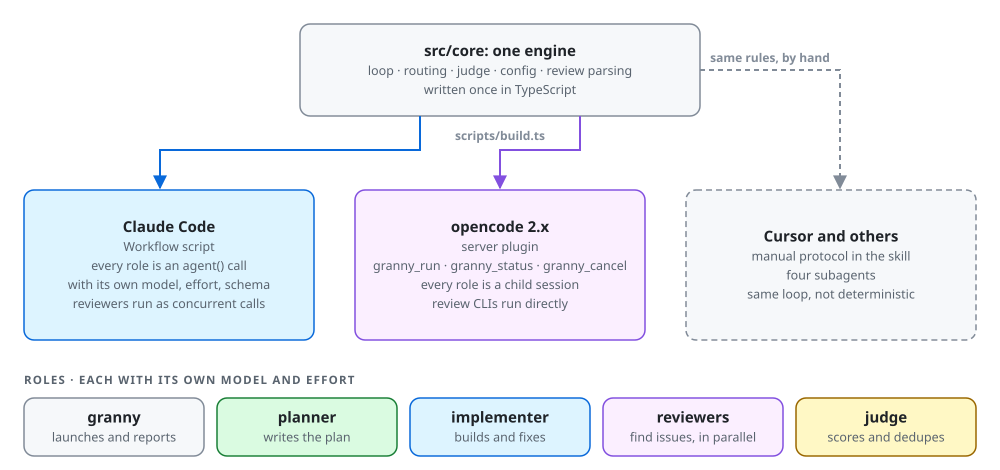

# granny-workflow

An agent skill that takes a plan to a PR-ready branch: an **implementer** builds it stage by stage, any number of **reviewers** - Codex, a host model, any CLI - review every stage in parallel, P0/P1 findings go straight back to the implementer, a **judge** scores the rest and merges duplicates, and the findings that matter go back to the implementer until the review is clean. **Granny** - the agent you talk to - prepares the run, launches it, and reports. Nothing is pushed; you decide what happens next.

<picture>
  <source media="(prefers-color-scheme: dark)" srcset="docs/images/loop-dark.svg">
  
</picture>

<details>
<summary>The same loop as text</summary>

```
before the first stage: reuse the branch's worktree or create one; everything below runs there
given a plan: plan review ─► the same reviewers, routing and cap; the implementer fixes the plan in place (never committed)
     ├─ clean or residual-only ─► stage 1
     └─ round-cap or review-failed ─► stop and report; nothing is implemented
for each stage:
  implementer builds the stage ─► every reviewer reviews it, in parallel (base = stage start sha)
     ├─ a reviewer fails, then fails its one retry ─► stage review-failed
     ├─ no reviewer reports a finding ─────────────► stage clean
     └─ P0/P1 findings go straight to the implementer; the judge scores the rest 0-100 and merges duplicates
          ├─ any P0/P1, or score > threshold ─► implementer fixes those ─► review again
          └─ none ─► stage done; the rest are "residual" for you
     cap: maxRounds reviews per stage
after the last stage: final check (gates, clean tree, no AI trailers, PR body) ─► report ─► wait
```

</details>

The loop is code, not a prompt: on Claude Code and opencode an engine drives every step, so the threshold, round cap and stop conditions hold every time.

- **Worktree** - the run works in the branch's own git worktree: the one that already has the branch checked out, or a new one next to the repo. Your main checkout stays as it is, and granny never removes the worktree.
- **Planner** - no plan yet? Give granny the goal instead: a planner agent explores the repo, writes the plan to the git-excluded `.granny/plans/<branch>.md` and proposes the stages, the plan review cleans it, and the run stops for your approval. Approve (or edit) and granny implements it in a second run.
- **Plan review** - given plan files, the reviewers check the plan against the actual repo before anything is built; the implementer fixes it in place until it is clean, and a plan review that cannot get there stops the run.
- **Reviewers** - as many as you configure, of any kind: Codex (the CLI or OpenAI's Codex plugin), a host model, or any CLI that answers a prompt. They all review every round at the same time; one that fails twice ends the stage `review-failed` instead of reading as clean.
- **Judge** - P0/P1 findings skip it and go straight to the implementer. It scores every other finding 0-100 and merges duplicates across reviewers; findings above the threshold are fixed, the rest are left for you as residual.

## Hosts

<picture>
  <source media="(prefers-color-scheme: dark)" srcset="docs/images/hosts-dark.svg">
  
</picture>

| host | engine | status |
|---|---|---|
| Claude Code | Workflow script (`engines/claude-code/workflow.js`): every role is an `agent()` call with its own model, effort and JSON schema; the reviewers are concurrent calls | full |
| opencode 2.x | server plugin (`engines/opencode/plugin/granny-workflow/`): every role is a child session with its own model and permissions; review commands run directly, concurrently with agent reviewers | full |
| Cursor | none - the skill walks the agent through the same loop with four subagents | manual, not deterministic |

## Install

```sh
npx skills add LibirSoft/grannyFlow
```

This puts `skills/granny-workflow/` where your agents look for skills. Then, per host:

- **Claude Code** - nothing else. Optional: OpenAI's Codex plugin (`/plugin marketplace add openai/codex-plugin-cc`, then `/plugin install codex@openai-codex`); the default reviewer uses it when it is installed and `node` is on `PATH`.
- **opencode** - install the plugin globally (and optionally the `granny` primary agent), then restart the service. A per-project install breaks with worktrees on, since the role sessions run in the worktree, where the plugin is missing:

  ```sh
  cp -r <skill-dir>/engines/opencode/plugin/granny-workflow ~/.config/opencode/plugins/
  cp <skill-dir>/engines/opencode/agents/granny.md ~/.config/opencode/agents/   # optional; set its model:
  opencode service restart
  ```

- **Cursor** - copy the subagents and set `model:` in each:

  ```sh
  cp <skill-dir>/engines/cursor/agents/*.md ~/.cursor/agents/
  ```

The default is one reviewer, [Codex](https://github.com/openai/codex); install it and log in, or configure other reviewers: a host model (`"engine": "agent"`) or any CLI that answers a prompt (`"engine": "command"`, e.g. `"opencode run -m <provider/model> {prompt}"`). With the default engine `auto`, Claude Code runs the Codex review through OpenAI's [Codex plugin for Claude Code](https://github.com/openai/codex-plugin-cc) when it is installed and `node` is on `PATH`, and through the Codex CLI (`codex exec review`) otherwise; opencode always uses the CLI unless you set `"engine": "codex-plugin"`. The run log says which one ran.

## Use

Ask your agent to implement a plan with granny:

> implement plans/auth/plan.md with granny - stage 1: WP-01..03, stage 2: WP-04..06

No plan yet? Ask granny to plan it first:

> plan OAuth login with granny on feat/oauth

The planner writes `.granny/plans/feat-oauth.md` with work orders and proposed stages, the reviewers review it, and the run stops: you get the plan, the stages and the planner's open questions. Once you approve, granny launches the implementation run with that plan and those stages.

Granny gathers the inputs (repo, branch, base, plan files, context files, stages), runs the preflight (reviewers ready, git-excluded work dir), launches the run and tells you the run id. Given plan files, the run reviews the plan first: the reviewers check it against the actual repo (wrong assumptions, missing steps, risky ordering, untestable acceptance criteria, version drift), the implementer fixes the accepted findings in the plan files in place - with a dated `rN deltas` section at the top, never committed - and the plan is reviewed again until it is clean. If the plan review hits the round cap or a reviewer fails, the run stops before implementing anything and reports. The run works in the branch's own git worktree: the one that already has the branch checked out, or a new one at `<parent of repo>/<repo name>-worktrees/<branch-slug>`, created for the branch or from `base`; your main checkout stays as it is. When it ends you get the worktree path and, per stage: commits, gate numbers, review rounds, outcome and the findings left for you; plus the final check and the PR body at `.granny/PR-BODY.md` in the worktree. Review and push from the worktree; granny never removes it.

## Configure

Three layers, later wins: `~/.config/granny/config.json`, `<repo>/granny.config.json`, and per-run overrides.

```json
{
  "roles": {
    "granny":      { "model": { "claude-code": "opus", "opencode": "anthropic/claude-opus-5-5" } },
    "implementer": { "model": "opus", "effort": "high" },
    "judge":       { "model": { "claude-code": "sonnet", "opencode": "anthropic/claude-sonnet-5-5" } }
  },
  "reviewers": [
    { "name": "codex", "engine": "auto" },
    { "name": "opus",  "engine": "agent", "model": { "claude-code": "opus", "opencode": "anthropic/claude-opus-5-5" } }
  ],
  "threshold": 70,
  "maxRounds": 4,
  "gates": ["bun test", "bun run check", "bun run build"]
}
```

| key | default | |
|---|---|---|
| `roles.<role>.model` | session model; judge `sonnet` on Claude Code | one string for every host, or `{ "claude-code": …, "opencode": … }` |
| `roles.<role>.effort` | inherit | Claude Code only; on opencode use a `#variant` model suffix |
| `reviewers` | `[{ "name": "codex", "engine": "auto" }]` | all review every round, in parallel; each has a unique `name`, an `engine` and its own `model`/`effort` |
| `reviewers[].engine` | `auto` | `auto`: the Codex plugin when installed and `node` is on `PATH` (Claude Code only), else the Codex CLI; `codex-plugin`: the plugin, required; `codex`: the CLI; `agent`: a host model (Claude models only on Claude Code); `command`: any CLI, with `{base}`, `{out}`, `{model}` and `{prompt}` placeholders |
| `reviewers[].mode` | `review` | `adversarial-review` runs the Codex plugin's adversarial review, optionally steered by `focus` |
| `threshold` | `70` | findings scoring strictly above it are fixed; P0/P1 always are, without the judge |
| `maxRounds` | `4` | review rounds per stage, and for the plan review |
| `planReview` | `true` | review the plan files before stage 1 when the run has a `plan`; skipped when it resumes with `fromStage` |
| `gates` | `auto` | agents discover test/lint/build/typecheck, or list them |
| `worktree` | `true` | work in the branch's own git worktree; `false` works in `repo` on the branch you checked out |
| `worktreeDir` | `<parent of repo>/<repo name>-worktrees` | where new worktrees go; absolute, or relative to the repo's parent |
| `aiAttribution` | `false` | forbid Co-Authored-By / "Generated with" lines |
| `language`, `rules`, `base`, `workDir` | | see the reference |

### Several reviewers

Codex, Opus and GLM reviewing every stage. On opencode every reviewer that is not Codex can be an `agent` on a provider model:

```json
{
  "reviewers": [
    { "name": "codex", "engine": "auto" },
    { "name": "opus", "engine": "agent", "model": { "opencode": "anthropic/claude-opus-5-5" } },
    { "name": "glm", "engine": "agent", "model": { "opencode": "opencode/glm-5.3-flash-free" } }
  ]
}
```

A Claude Code agent runs Claude models only, so there GLM reviews through a CLI that reaches it - `opencode run`, with `{prompt}` filled with the review prompt:

```json
{
  "reviewers": [
    { "name": "codex", "engine": "auto" },
    { "name": "opus", "engine": "agent", "model": "opus", "effort": "high" },
    { "name": "glm", "engine": "command", "command": "opencode run -m opencode/glm-5.3-flash-free {prompt}" }
  ]
}
```

Full reference: [skills/granny-workflow/references/config.md](skills/granny-workflow/references/config.md).

## Resume

- Claude Code: relaunch the Workflow with `resumeFromRunId`; finished agent calls come back from cache.
- opencode: no cache - relaunch with `fromStage` set to the first unfinished stage.

Either way the run works in the worktree the first launch used.

## Develop

```sh
bun install
bun run build   # regenerates skills/granny-workflow/engines/* and references/prompts.md from src/
bun run check   # typecheck + tests
```

`src/core` holds the loop, config, prompts and review parser, shared by both engines; `src/adapters` wires them to each host. The generated engine files are committed so the skill installs without a build step, and the tests fail when they drift from `src/`.

## License

MIT
