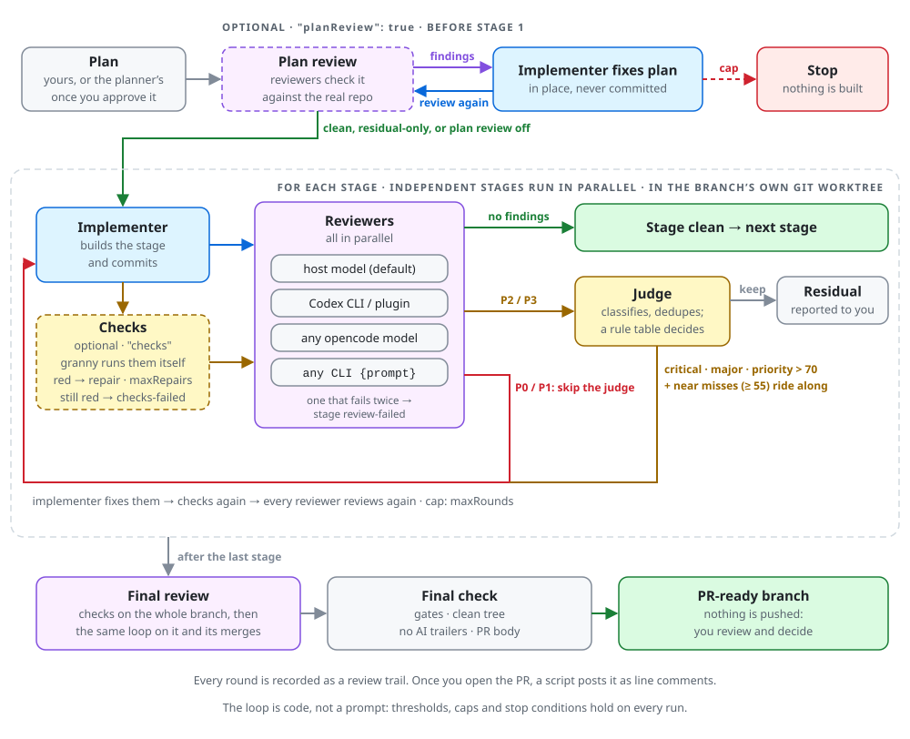

# granny-workflow

Granny turns a plan into a PR-ready branch. An **implementer** agent builds the plan stage by stage, **reviewers** check every stage, and a **judge** decides which findings are worth fixing. The loop repeats until the review is clean.

Nothing is pushed. You get a branch, a PR body and a short report, and you decide what happens next.

It runs on Claude Code, opencode and omp (oh-my-pi), where the loop is code, so the round cap and the thresholds hold on every run. On Cursor the agent follows the same steps by hand.

## Install

```sh
npx skills add LibirSoft/grannyFlow
```

Claude Code needs nothing more. The other hosts need one more step, where `<skill-dir>` is the directory the skill landed in (for example `~/.claude/skills/granny-workflow`):

```sh
# opencode: install the plugin, then restart
cp -r <skill-dir>/engines/opencode/plugin/granny-workflow ~/.config/opencode/plugins/
opencode service restart

# omp: install the extension, then quit omp and start it again
cp -r <skill-dir>/engines/omp/extensions/granny-workflow ~/.omp/agent/extensions/

# Cursor: copy the subagents, then set `model:` in each file
cp <skill-dir>/engines/cursor/agents/*.md ~/.cursor/agents/
```

omp must find the skill in `~/.omp/agent/skills/` or `~/.agents/skills/`. Link it there if it landed somewhere else.

## Setup

In your project, ask your agent:

> granny setup

It asks five questions and writes `granny.config.json` in your repo, or your user config for every project (see [Configure](#configure)). It does not start a run. The questions are: how strict the review is, who reviews, which checks to run, which model each role uses, and where to save.

Strictness sets how many findings go back to the implementer. P0/P1 findings and critical or major issues are always fixed. The preset decides the rest:

| preset | threshold | |
|---|---|---|
| strict | 55 | fixes more findings |
| normal | 70 | the default |
| relaxed | 85 | fixes fewer findings |

## Use

With a plan:

> implement plans/auth/plan.md with granny - stage 1: WP-01..03, stage 2: WP-04..06

Without a plan, granny plans first:

> plan OAuth login with granny on feat/oauth

A planner writes the plan to `.granny/plans/feat-oauth.md` and proposes the stages, then the run stops. Approve the plan or edit it, and a second run builds it.

When a run ends you get, for each stage, the commits, the review rounds, the outcome and the findings left for you to decide. A run that ends PR-ready removes the worktree it created and leaves the branch: check it out in your repo, review and push from there. The PR body is then at `.granny/branches/<branch-key>/PR-BODY.md` in your repo. A run that needs more work keeps its worktree and says why.

### Post the review to the PR

Every review round is recorded: the findings, the judge's verdict on each one and what became of it. After you open the PR, ask your agent to post the record, or run this in the checkout that has the branch:

```sh
node <skill-dir>/scripts/pr-comments.mjs
```

Each round becomes one review on the PR, and a finding sits on its line. It works for a GitHub PR and a GitLab MR. For any other platform, `--out <file>` writes the rounds as JSON. Details: [review trail](skills/granny-workflow/references/config.md#review-trail).

## Review only: `granny judge`

To review a branch without changing it, ask your agent:

> granny judge

One agent reviews the checkout's `<base>...HEAD` and a second agent rates each finding. The report goes to `.granny/reviews/<date>-<branch>.md`. Nothing is fixed or committed, and uncommitted files are not reviewed. If no reviewer or judge model is set yet, granny asks first.

The report groups the findings by that rating: `critical` under P0, `major` under P1, `moderate` under P2 and `minor` under P3. What the second agent refutes goes under `Dismissed by the judge`, with its reason. Details: [judge.md](skills/granny-workflow/references/judge.md).

## How it works

<picture>
  <source media="(prefers-color-scheme: dark)" srcset="docs/images/loop-dark.svg">
  
</picture>

- **Worktree** - the run works in the branch's own git worktree, next to your repo. Your main checkout is not touched. When the run ends PR-ready, granny removes the worktree it created and leaves the branch; "keepWorktree": true keeps it.
- **Implementer** - builds one stage, commits it, and later fixes the findings sent back to it.
- **Checks** (optional) - your test, typecheck or lint commands. Granny runs them itself, and a red one goes back to the implementer before any review.
- **Reviewers** - all of them review every stage at the same time.
- **Judge** - P0/P1 findings skip it and go straight back. It rates the rest by impact, likelihood and fix cost, and code turns the rating into a priority. Critical and major issues are always fixed, the others when their priority is above the threshold. A finding the judge gives one of your config tags gets the tag's points on its priority, or is fixed outright. What is not fixed is listed for you, with the reason.
- **Final review** - after the last stage, the whole branch is reviewed once more for problems between stages.

Stages that do not depend on each other run at the same time, also in other repos. The full rules: [the decision table](skills/granny-workflow/references/config.md#the-decision-table).

## Configure

`granny setup` covers the common choices. To edit by hand: settings are read from the user config (`$GRANNY_CONFIG` when it is set, else `$XDG_CONFIG_HOME/granny/config.json`, else `~/.config/granny/config.json`), then `<repo>/granny.config.json`, then the run's own overrides. Later wins.

```json
{
  "threshold": 70,
  "maxRounds": 4,
  "reviewers": [
    { "name": "reviewer", "engine": "agent" },
    { "name": "codex", "engine": "auto" },
    { "name": "kimi", "engine": "opencode", "model": "kimi-code-plan-global/k3.1-pro", "effort": "max" }
  ],
  "checks": [
    { "name": "test", "run": "bun test" }
  ]
}
```

| key | default | what it does |
|---|---|---|
| `threshold` | `70` | findings with a priority above it are fixed |
| `alwaysFix` | `["critical", "major"]` | impact classes that are always fixed |
| `rideAlong` | `55` | findings at or above it are fixed too, when the round already has a fix |
| `maxRounds` | `4` | review rounds per stage |
| `reviewers` | the host model | who reviews, in any mix (see below) |
| `checks` | none | commands granny runs before every review |
| `planReview` | `false` | review the plan before building it; uses many more tokens |
| `finalReview` | `true` | review the whole branch after the last stage |
| `parallel` | `true` | run independent stages at the same time |
| `keepWorktree` | `false` | keep the run's worktree at the end instead of removing it |
| `stepAgents` | `false` | build a stage with one agent per step: [step agents](skills/granny-workflow/references/config.md#step-agents) |
| `tags` | none | kinds of small finding that get points or a straight fix: [config tags](skills/granny-workflow/references/config.md#tags) |
| `roles.<role>.model` | the session model | model per role: `implementer`, `planner`, `judge`, `granny`, `helper` |

A reviewer is one of these:

- `agent` - a model of your host. This is the default.
- `auto` - Codex. Install the [Codex CLI](https://github.com/openai/codex) and run `codex login`. Not on omp.
- `opencode` - any model [opencode](https://opencode.ai) reaches, such as Kimi or GLM, on every host: [opencode reviewers](skills/granny-workflow/references/config.md#opencode-reviewers).
- `command` - any other CLI.

A config tag names a kind of small finding that should not be left behind. Say `granny tag` to your agent, or run the script yourself from your repo (with `--repo <dir>` from anywhere else):

```sh
node <skill-dir>/scripts/tags.mjs add typo --fix --description "a misspelled word in a comment, a string or a doc"
```

In the config file, with a second tag that adds 20 points to the priority instead:

```json
{
  "tags": {
    "typo": { "description": "a misspelled word in a comment, a string or a doc", "fix": true },
    "naming": { "description": "a name that says something other than what the code does", "points": 20 }
  }
}
```

Every key and more examples: [config.md](skills/granny-workflow/references/config.md).

## Hosts

| host | how the loop runs |
|---|---|
| Claude Code | a Workflow script; every role is its own agent with its own model |
| opencode | a server plugin; every role is its own session with its own model |
| omp | an extension in your omp session; every role is its own `omp` process with its own model |
| Cursor | the agent follows the steps by hand with four subagents - not deterministic |

On Claude Code a small Haiku helper agent runs the plain commands (git, checks), because Workflow scripts have no shell ([claude-code#98566](https://github.com/anthropics/claude-code/issues/98566)). The judge uses Haiku there too, unless you set its model.

To resume a stopped run: on Claude Code relaunch it with `resumeFromRunId`; on opencode and omp relaunch it with `fromStage` set to the first unfinished stage.

## Develop

```sh
bun install
bun run build   # regenerates the engines, scripts/pr-comments.mjs, scripts/tags.mjs and references/prompts.md from src/
bun run check   # typecheck + tests
```

`src/core` holds the loop, shared by every engine. `src/adapters` connects it to each host, `src/pr` posts the review trail, and `src/tags` is the `granny tag` command. The generated engine files are committed, so the skill installs without a build step.

## License

MIT
